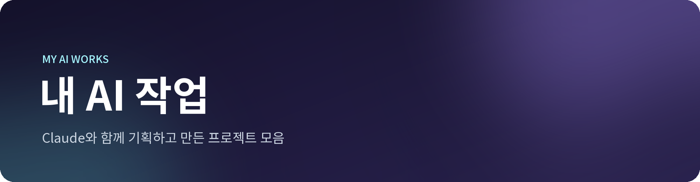
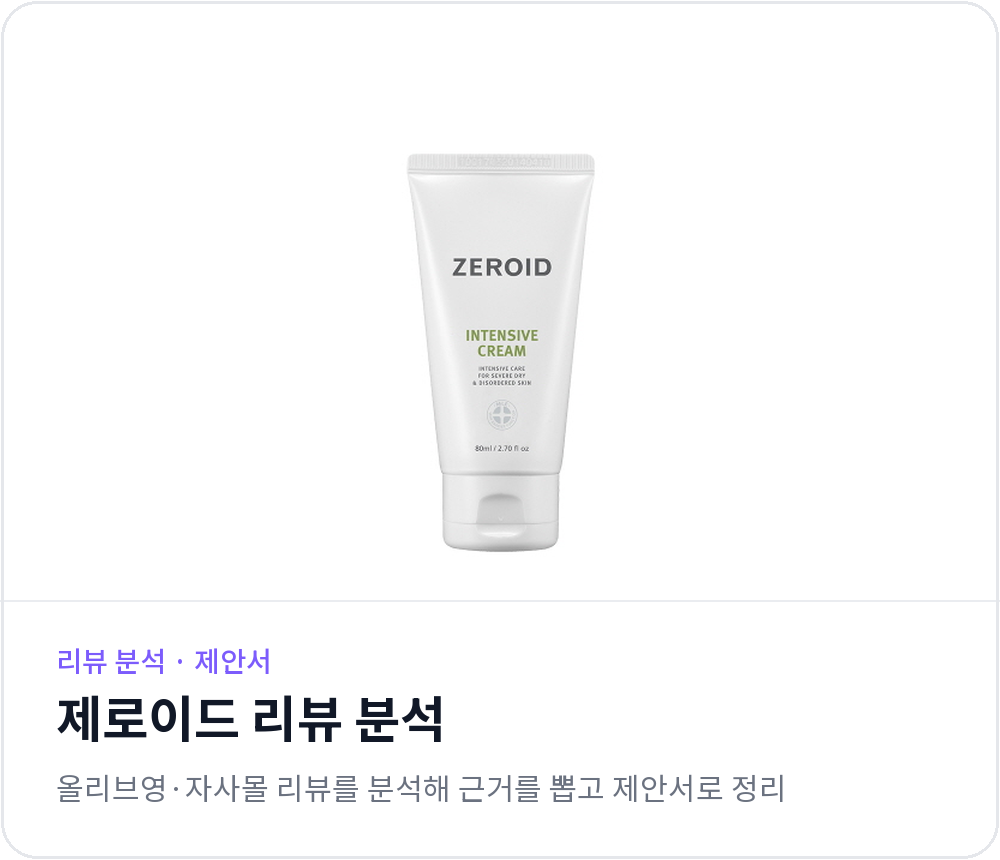
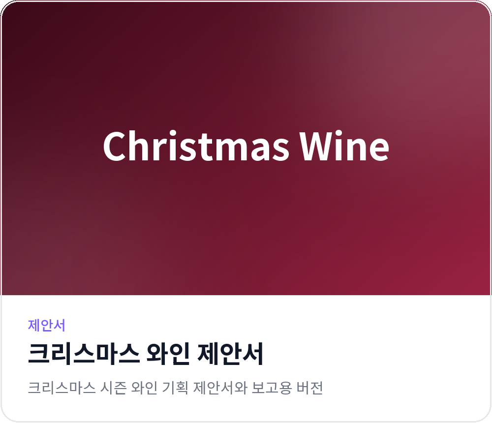

  

기획 · 조사 · 데이터 분석 · 제안서 · 콘텐츠 제작을 AI와 함께 해 본 기록입니다.
카드를 누르면 해당 프로젝트 폴더로 이동합니다.

 

<!-- PROJECTS:START -->

  
  

  
  

  
  

  

<!-- PROJECTS:END -->

 

## 업데이트

<!-- UPDATES:START -->
- **2026-11-10** · 건강기능식품 조회 서비스 추가
- **2026-11-09** · 저장소 시작, 프로젝트 6개 추가
<!-- UPDATES:END -->
