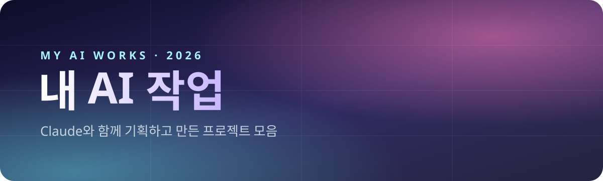
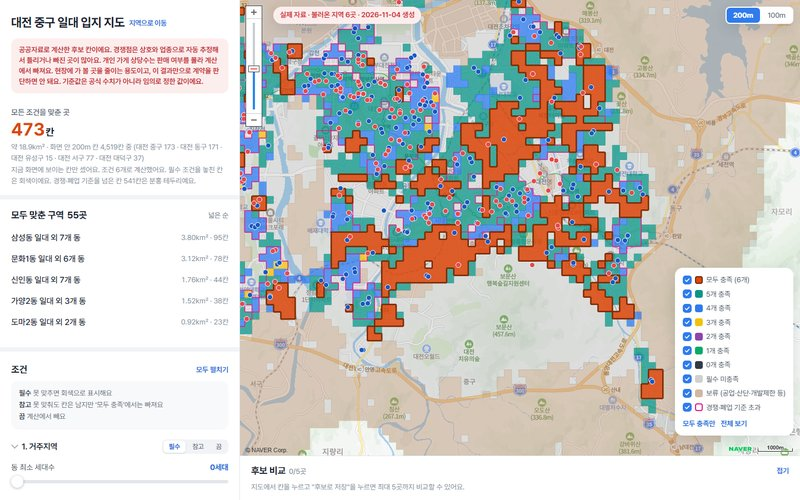
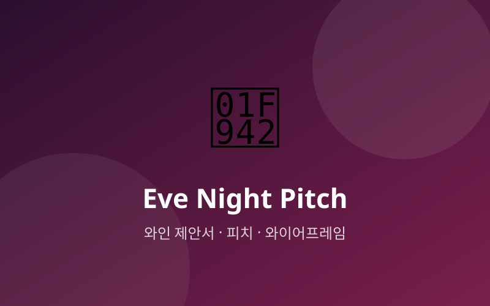

 

**기획 · 조사 · 데이터 분석 · 제안서 · 콘텐츠 제작**을 AI와 함께 해 본 기록입니다.

 

## ✦ Projects

<table>
<tr>
<td width="50%" valign="top">

### 🗺️ [케이크 매장 입지 지도](창업/)
공공데이터로 레터링 케이크 매장 후보 지역을 좁혀 보는 지도. 200m·100m 칸마다 인구·교통·경쟁 가게를 판정해 색으로 보여 줍니다.

`지도` `공공데이터` `Python` `Naver Map`
</td>
<td width="50%" valign="top">

### 🧴 [제로이드 리뷰 분석 · 제안서](제로이드/)
올리브영·자사몰 리뷰를 수집·분석해 근거 문장을 뽑고, 진(zine)·미니멀·맥시멀 스타일 제안서로 만들었습니다.

`리뷰 분석` `크롤링` `제안서` `Python`
</td>
</tr>
<tr>
<td width="50%" valign="top">

### 📚 [책 정보 인스타툰](인스타툰/)
고전·인문 책을 소개하는 인스타툰 제작 파이프라인. 조사 → 콘티 → 그림 → 말풍선 → 캡션까지 스킬로 자동화했습니다.

`인스타툰` `이미지 생성` `Claude Skills`
</td>
<td width="50%" valign="top">

### 🧩 [이미지 MCP 설치 프로그램](MCP%20설치/)
개발 경험이 없는 사람도 `install.bat` 하나로 Claude Code에 GPT Image MCP를 연결하게 만든 설치 도구와 이상상황 시험 기획서.

`MCP` `PowerShell` `설치 자동화`
</td>
</tr>
<tr>
<td width="50%" valign="top">

### 🍷 [크리스마스 와인 제안서](베버%20제안서/)
크리스마스 시즌 와인 기획 제안서와 보고용 버전.

`제안서` `HTML`
</td>
<td width="50%" valign="top">

### 🥂 [와인 제안서 2차](베버%20제안서%202/)
이브 나이트 컨셉의 제안서 · 피치 · 와이어프레임 · 리뷰 페이지.

`제안서` `피치` `와이어프레임`
</td>
</tr>
</table>

 

## ✦ Updates

| 날짜 | 내용 |
|---|---|
| 2026-11-09 | 저장소 시작 · 프로젝트 6개 추가 |

 

Made with ☕ and Claude

