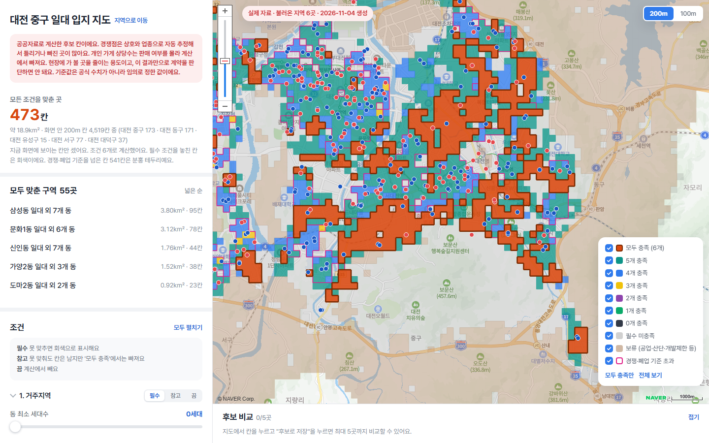
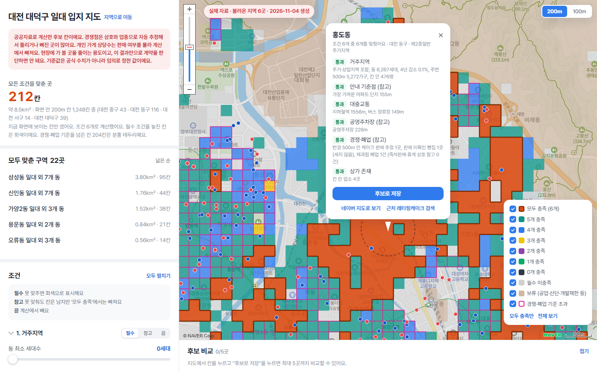
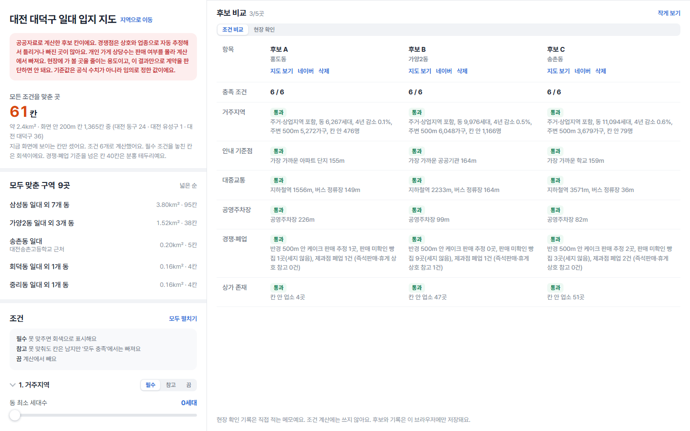
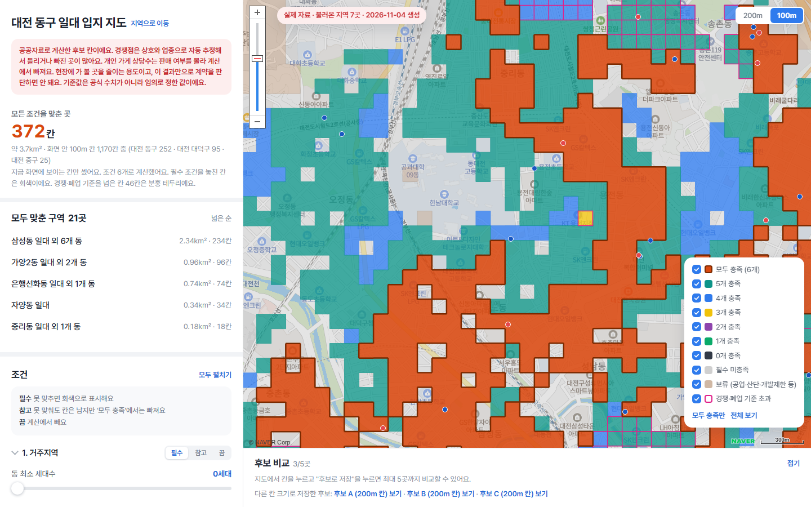
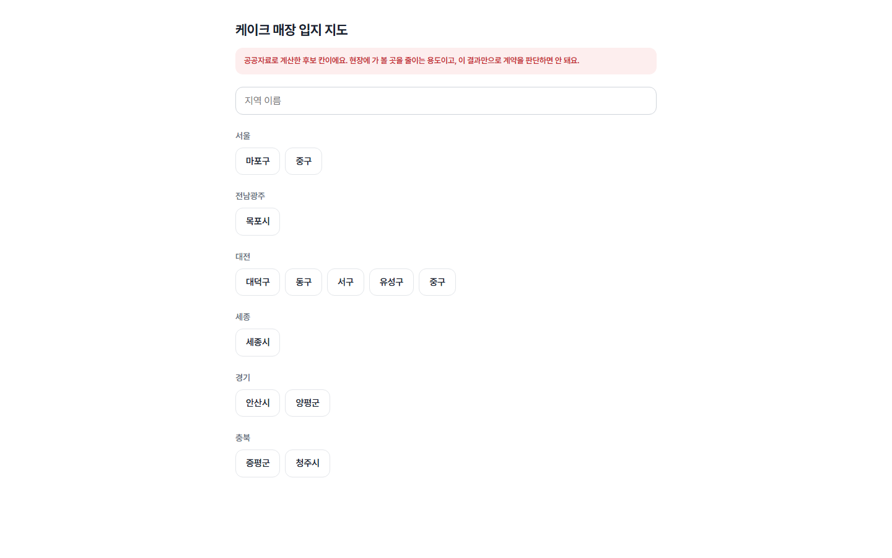
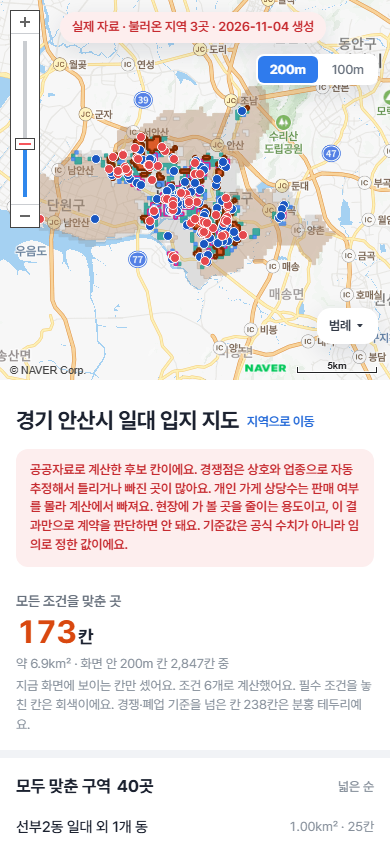

# 케이크 매장 입지 지도

레터링 케이크 매장을 열 만한 곳을 **공공데이터로 좁혀 보는 지도**입니다. 전국 공통 200m(또는 100m) 칸마다 거주 인구, 교통, 경쟁 가게, 상가 여부 등을 판정해 색으로 보여 줍니다.

> 공공자료로 계산한 후보 칸입니다. 임대료·공실·실제 매출·유동인구는 들어 있지 않습니다. 현장에 가 볼 곳을 줄이는 용도이고, 이 결과만으로 창업이나 계약을 판단하면 안 됩니다.

- 어떻게 만들었는지: [개발과정.md](개발과정.md)
- 어떤 자료를 썼는지: [자료출처.md](자료출처.md)

## 결과 화면

### 대전 중구에서 시작한 지도 (200m 칸)
주황색이 모든 조건을 맞춘 칸입니다. 대전 중구로 들어와도 옆 동구·서구·유성구·대덕구 칸이 이어서 보입니다. 왼쪽에는 화면 안의 칸 수와 "모두 맞춘 구역" 목록이 나옵니다.



### 칸 정보 창
칸을 누르면 조건 6개의 통과 여부와 근거(거리, 가구 수, 경쟁 가게 수 등)가 나옵니다. 점선 원은 경쟁 가게를 세는 반경입니다.



### 후보 비교
마음에 드는 칸을 최대 5곳까지 후보로 저장해 조건별로 나란히 비교합니다. "현장 확인" 탭에는 직접 가서 확인할 항목을 적을 수 있습니다.



### 100m 칸
오른쪽 위 버튼으로 칸 크기를 200m ↔ 100m로 바꿉니다.



### 지역 선택 첫 화면과 휴대폰 화면

| 지역 선택 | 휴대폰 |
|---|---|
|  |  |

## 직접 실행해 보기

`index.html`을 더블클릭하면 브라우저 보안 규칙 때문에 지역 자료와 지도 인증이 실패합니다. 간단한 로컬 서버로 열어야 합니다. 파이썬이 설치돼 있어야 합니다.

**방법 1:** 저장소를 내려받은 뒤 `지도_열기.bat`을 더블클릭합니다(Windows). 검은 창이 열려 있는 동안 지도가 동작하고, 창을 닫으면 꺼집니다.

**방법 2:** 직접 명령을 실행합니다.

```bash
cd 지도/dist
python -m http.server 8000
```

그다음 브라우저에서 `http://localhost:8000`을 엽니다. 처음 화면에서 지역을 고르면 지도가 열립니다.

- 배경 지도는 네이버 지도 API를 씁니다. `localhost`가 허용 주소로 등록돼 있어 위 방법으로 열면 배경 지도가 뜹니다. 다른 주소(예: 다른 웹사이트)에 올리면 배경 지도는 인증에 실패합니다.
- 큰 지역(청주 등)을 100m로 바꾸면 불러오는 데 몇 초 걸립니다.

## 기능

- **조건 6개 + 보류 필터:** 조건마다 `필수 / 참고 / 끔`을 고릅니다. 필수를 못 맞추면 회색, 참고를 못 맞추면 "모두 충족"에서만 빠집니다. 기준값은 슬라이더로 바꿉니다.
- **충족 개수별 색:** 모두 충족(주황), 5개·4개·3개… 충족, 필수 미충족(회색), 보류(갈색).
- **경쟁·폐업 초과 표시:** 참고 조건인 경쟁·폐업 기준을 넘은 칸은 분홍 테두리로 구별합니다.
- **이어 보기:** 화면 근처 지역 자료를 자동으로 불러와 지역 경계를 넘어 이어서 그립니다.
- **화면 기준 집계:** 왼쪽 숫자와 구역 목록은 지금 화면에 보이는 칸만 셉니다.
- **후보 비교:** 최대 5곳, 브라우저에만 저장됩니다.
- **칸 크기 전환:** 200m / 100m.
- **휴대폰 화면:** 지도 아래에 목록이 오고, 칸 정보는 아래에서 올라오는 창으로 보입니다.

## 판정 조건 (시작값)

시작값은 비교를 시작하려고 정한 값이며 공식 기준이 아닙니다.

| 조건 | 방식 | 판정 |
|---|---|---|
| 1. 거주지역 | 필수 | 칸이 주거·상업지역에 걸침, 칸 주변 500m 1,000가구 이상, 동 4년 인구 감소율 20% 이하 |
| 2. 안내 기준점 | 참고 | 지하철역·대형마트·학교·공공기관·아파트 중 하나가 300m 안 |
| 3. 대중교통 | 필수 | 지하철역 800m 또는 버스 정류장 300m 안 |
| 4. 공영주차장 | 참고 | 300m 안 |
| 5. 경쟁·폐업 | 참고 | 반경 500m 안 케이크 판매 추정 가게 2곳 이하, 최근 3년 제과점 폐업 10건 이하 |
| 6. 상가 존재 | 필수 | 칸 안에 기존 업소 1곳 이상 |
| 보류 | 필터 | 개발제한구역, 보전지역, 공업지역, 주거·상업지역이 없는 산업단지 칸 |

## 자료가 있는 지역 (13곳)

세종시, 대전 5개 구, 경기 안산시·양평군, 서울 마포구·중구, 충북 청주시·증평군, 전남 목포시.

| 지역 | 200m 칸 수 | 모두 충족 (그 지역만 셈) |
|---|---|---|
| 세종시 | 11,636 | 100 |
| 대전 동구 | 3,404 | 171 |
| 대전 중구 | 1,543 | 173 |
| 대전 서구 | 2,406 | 98 |
| 대전 유성구 | 4,383 | 141 |
| 대전 대덕구 | 1,739 | 39 |
| 안산시 | 4,097 | 173 |
| 서울 마포구 | 606 | 1 |
| 서울 중구 | 252 | 29 |
| 청주시 | 23,485 | 208 |
| 양평군 | 21,986 | 21 |
| 목포시 | 1,378 | 107 |
| 증평군 | 2,044 | 12 |

## 폴더 구성

| 폴더·파일 | 내용 |
|---|---|
| `지도/dist/` | **결과물.** 지도 화면(`index.html`)과 지역 자료(`data/regions/<시군구코드>.json`, 100m는 `_100.json`) |
| `지도/scripts/`, `지도/reference/` | 자동 검사. `node scripts/check.mjs`로 안산 기준 결과(200m 173칸, 100m 488칸)가 바뀌지 않았는지 확인 |
| `자료생성/수집/` | 공공데이터를 받아 지역 자료를 만드는 파이썬 코드. `build_all.py`가 경계 자르기 → 수집 → 경쟁점 판정 → 지도 자료 생성을 차례로 실행 |
| `초기시제품/` | 가짜 데이터로 만든 첫 버전 화면과 서버, Leaflet 지도 버전 |
| `문서/` | 기획 문서, 입지 조건 조사 노트·보고서, 작업 기록(`인수인계.md`) |
| `screenshots/` | 위 화면 캡처 |
| `개발과정.md`, `자료출처.md` | 개발 과정, 자료 출처 |

`자료생성/` 코드는 원자료(약 3.5GB)와 API 키가 있어야 돌아갑니다. 원자료와 키는 저장소에 넣지 않았습니다(`자료출처.md` 참고).

## 검사

```bash
cd 지도
node scripts/check.mjs
```

화면 코드의 판정 부분을 Node에서 돌려, 안산 자료의 결과가 기준(200m 173칸, 100m 488칸, 조건 모드 18가지)과 같은지 확인합니다.

## 알려진 한계

- **경쟁 가게:** 판매 여부를 모르는 동네 빵집은 기본 판정에서 빠져 경쟁이 실제보다 적게 계산됩니다(체크 상자로 반대 가정을 켤 수 있음). 인스타그램으로만 영업하는 가게는 없습니다.
- **옆 지역 자료:** 자료를 만든 옆 지역만 셉니다. 안산·양평·목포는 경계 근처 칸이 옆 지역 가게를 놓칩니다.
- **기준값:** 서울과 시골에 같은 값을 씁니다.
- **인구:** SGIS 100m 값에는 통계 보호용 노이즈가 있어, 특히 100m 칸의 인구는 오차가 큽니다.
- **거리:** 직선거리입니다. 걷는 길이나 운전 경로가 아닙니다.
- **지하철역:** 2020년 기준 자료라 그 뒤 개통한 역이 빠졌을 수 있습니다.
