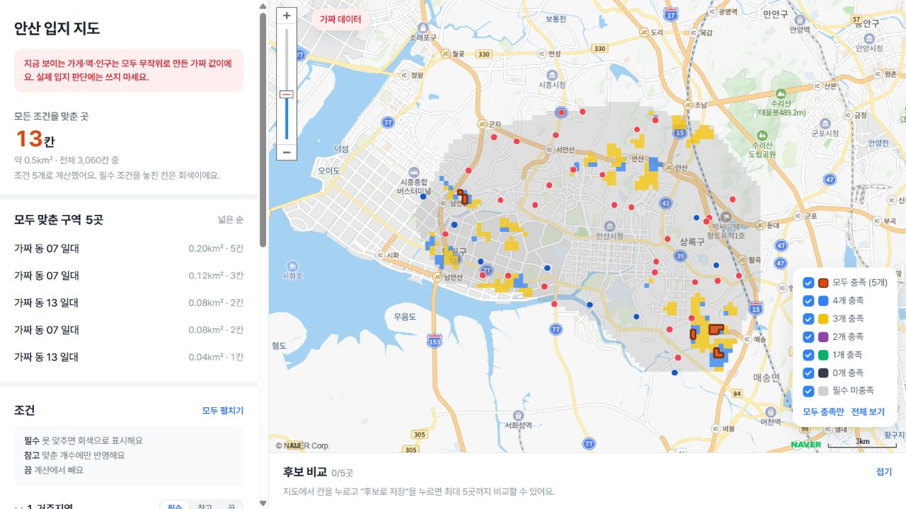

# 개발 과정

레터링 케이크 매장 후보 입지를 공공데이터로 좁혀 보는 지도를 만든 과정입니다. 날짜는 작업 파일과 작업 기록(`문서/인수인계.md`)에 남은 날짜를 기준으로 적었습니다. AI 도구(Claude, ChatGPT)와 대화하며 기획·조사·코드 작성을 진행했습니다.

## 한눈에 보기

| 단계 | 시기 | 한 일 | 남은 결과물 |
|---|---|---|---|
| 1. 기획 | 2026-11-02 | 창업 리스크 분석 기준을 정리하고, 범위를 "입지 분석 지도"로 좁힘 | `문서/창업분석_에이전트_프롬프트_v2.md`, `문서/창업_전_고려사항_100가지.md` |
| 2. 첫 시제품 | 2026-11-02 | 가짜 데이터로 화면과 조건 계산 흐름을 먼저 만듦 | `초기시제품/` |
| 3. 입지 조건 조사 | 2026-11-02 | 법령·통계·상권분석 방법을 조사해 지도 조건 7개를 정함 | `문서/research_notes/`, `문서/reports/` |
| 4. 지도 엔진 교체 | 2026-11-02 | Leaflet(오픈스트리트맵) → 네이버 지도로 바꿈 | `초기시제품/지도_Leaflet백업.html` |
| 5. 실제 공공데이터 연결 | 2026-11-02 ~ 03 | 안산시를 대상으로 인구·용도지역·상가·인허가·교통 자료를 200m 칸에 연결 | `자료생성/수집/` |
| 6. 경쟁점 자동 판정 | 2026-11-03 | 상호·업종·가맹 브랜드 정보로 "케이크를 파는 가게"를 자동 추정 | `자료생성/수집/classify_rivals.py` |
| 7. 전국 확장 구조 | 2026-11-03 ~ 04 | 시군구 단위로 자동 수집·생성하고, 오류를 자동 검사하는 구조로 바꿈 | `자료생성/수집/build_all.py` 등 |
| 8. 이어 보기·정확도 | 2026-11-04 | 지역 경계를 넘어 옆 지역 칸까지 이어서 보이게 하고, 칸과 테두리 어긋남을 고침 | `지도/dist/index.html` |
| 9. 100m 칸·속도 개선 | 2026-11-04 ~ 05 | 200m/100m 칸 전환을 넣고 불러오는 속도를 줄임 | `지도/dist/data/regions/*_100.json` |
| 10. 마무리 | 2026-11-05 ~ 09 | 공공데이터만으로는 실제 입지 판단이 어렵다는 한계를 확인하고 개발 종료, 저장소 정리 | 이 문서, `README.md` |

## 1. 기획

- 처음에는 "창업 리스크 분석 에이전트"를 구상했습니다. 창업 전에 따져야 할 항목 100가지와, 출처 등급(공공 통계 A ~ 판매자 자료 D)을 정한 분석 지침을 먼저 썼습니다.
- 진행하면서 범위를 **입지 분석 웹사이트**로 좁혔습니다. 경력·자금·가족 동의 같은 창업자 개인 정보와 손익 분석은 다루지 않기로 했습니다.

## 2. 첫 시제품 (가짜 데이터)

- 파이썬 로컬 서버와 웹 화면으로, 후보지 하나를 조사해 결과를 보여 주는 흐름을 만들었습니다.
- 실제 자료를 붙이기 전에 화면을 점검하려고 가짜 데이터 모드(`demo.py`)를 두었고, 실패한 항목은 0이 아니라 "확인 불가"로 남기도록 했습니다.
- 이 단계의 지도는 오픈스트리트맵(Leaflet)을 썼습니다.

## 3. 입지 조건 조사

- 법적 조건(건축물 용도, 영업 신고), 상권분석 방법론, 안산 지역 자료, 제과업 통계를 조사해 연구 노트 4개로 정리했습니다.
- 공식 기관이 정한 "입지 조건 개수"나 가중치는 찾지 못했습니다. 그래서 점수 합산 대신, **조건마다 필수 / 참고 / 끔**을 고르는 방식으로 정했습니다.
- 지도에서 자동으로 판정할 조건 7개와, 지도로는 알 수 없어 현장에서 확인할 조건 8개를 나눴습니다.

## 4. 지도 엔진 교체

- 지도를 네이버 지도(Dynamic Map)로 바꿨습니다.
- 칸 색칠은 캔버스, 구역 테두리는 SVG로 지도 위에 직접 그립니다.
- 이 버전을 ChatGPT Sites에 가짜 데이터로 먼저 올려 화면을 확인했습니다. 아래는 그때 화면입니다(가게·역·인구가 모두 무작위 값).

## 5. 실제 공공데이터 연결 (안산)

- 전국 공통 격자(EPSG:5179) 200m 칸을 기준으로 정했습니다. 칸 번호가 전국에서 겹치지 않아 지역을 늘리기 쉽습니다.
- 연결한 자료: SGIS 100m 인구·가구(신청 승인 2026-11-02), 행안부 동별 주민등록 인구, 국토부 용도지역·개발제한구역·산업단지, 소상공인 상가, 행안부 인허가(제과점·즉석판매·휴게음식점 개업·폐업), 버스 정류장, 지하철역, 공영주차장, 학교, 대형마트. 자세한 내용은 `자료출처.md`에 있습니다.
- 표준데이터에 없던 서해선 역 6곳, 아파트·공공기관은 버스 정류장 이름으로 위치를 보충했습니다.

## 6. 경쟁점 자동 판정

- "케이크를 파는 가게"를 사람이 하나씩 확인하지 않고 자동으로 추정하도록 규칙을 만들었습니다(전국 확장을 전제로 함).
- 규칙: 파리바게뜨·뚜레쥬르는 판매 → 호떡·도넛·떡케이크 등은 제외 → 공정위 가맹 브랜드 주요상품 → 상호에 "케이크" → 나머지는 미확인.
- 구글 지도, 카카오맵, 네이버 블로그 검색 등은 약관을 확인한 결과 쓰지 않았습니다.

## 7. 전국 확장 구조

- 지역 id를 시군구 코드로 바꾸고, 코드만 넣으면 경계 자르기 → 수집 → 경쟁점 판정 → 지도 자료 생성이 차례로 돌아가게 했습니다.
- **자동 오류 검사**를 넣었습니다. 계기는 인구가 중복 집계되어 한 읍의 인구가 230만 명으로 나온 오류였습니다. 지금은 통·반 인구 합계 대조, 100m 격자 인구와 주민등록 인구 비교(0.7~1.3배), 같은 가게 중복 제거(30m 안 비슷한 이름), API가 오류 없이 빈 결과를 주는 경우 재확인 등을 자동으로 검사합니다.
- 시험 지역 13곳(세종, 대전 5개 구, 안산, 서울 마포구·중구, 청주, 양평, 목포, 증평)을 만들었습니다.
- 웹 공개는 Cloudflare Pages에 올리고 Cloudflare Access로 접근을 제한했습니다.

## 8. 이어 보기와 정확도

- 어느 지역으로 들어가도 옆 지역 칸이 이어서 보이도록, 화면 근처 지역 자료를 불러와 한 지도에 그리게 했습니다. 지역 선택은 시작 위치나 먼 곳 이동용입니다.
- 칸 색과 분홍 테두리가 10px 넘게 어긋나는 문제가 있었습니다. 작은 그림을 크게 늘려 붙이던 방식을, 같은 모서리 좌표로 직접 칠하는 방식으로 바꿔 고쳤습니다.

## 9. 100m 칸과 속도 개선

- 칸 크기를 200m와 100m 중에서 고를 수 있게 했습니다. 지역마다 100m 자료 파일을 따로 만들고, 고친 코드로 다시 만든 200m 결과가 이전과 완전히 같은지 확인했습니다.
- 100m는 칸 수가 4배라 처음에는 청주 일대를 바꾸는 데 10.8초가 걸렸습니다. 결과가 바뀌지 않는 범위에서 계산을 줄여 첫 화면이 보이기까지 3.7초로 줄였습니다. 13개 지역 26개 파일에서 판정이 이전과 같은지 127가지 조건으로 비교했습니다.

## 10. 마무리와 한계

- 공공데이터에는 **임대료, 공실, 실제 매출, 유동인구**가 없습니다. 부동산·중개사가 가진 정보와 비교하면, 이 지도만으로 창업 입지를 판단하기에는 부족하다고 판단해 개발을 마쳤습니다.
- 이 지도는 "현장에 가 볼 곳을 줄이는 도구"로만 쓸 수 있고, 화면에도 그렇게 안내합니다.
- 저장소를 정리하면서 화면 캡처를 찍다가, 구역 목록을 눌러 지도가 크게 이동할 때 칸 색이 일부 빠지는 문제를 발견해 고쳤습니다(2026-11-09).
